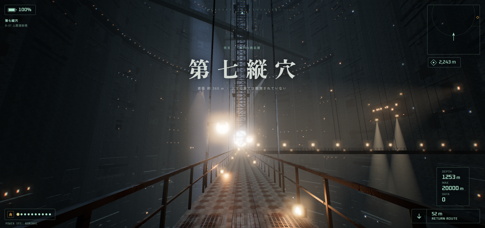
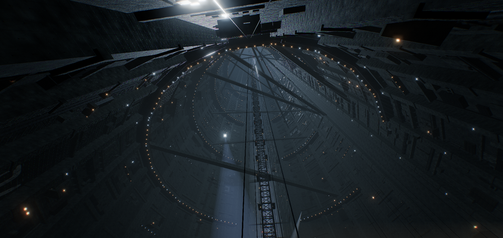
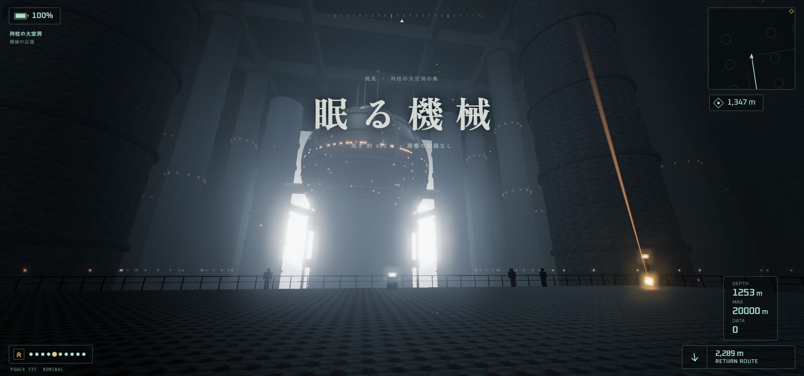
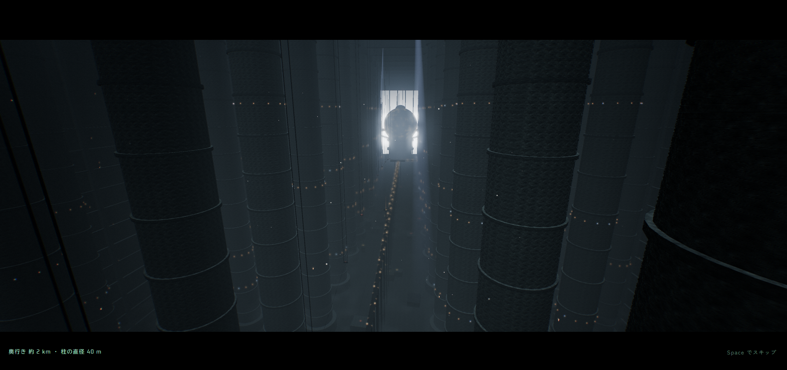
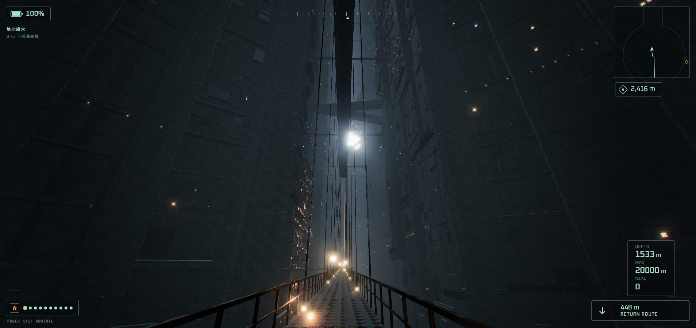
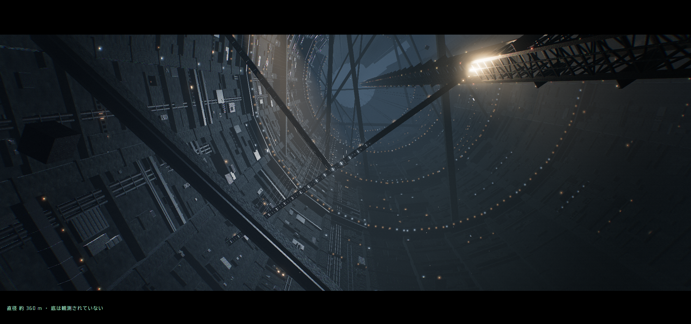

# 第七縦穴 — Megastructure Playable Mock

巨大構造物を探索するプレイアブルモックです。

## ティザームービー

▶ [YouTube で見る](https://youtu.be/v8jOTvvMXwQ)

## 遊び方

1. [`playable-mock.html`](playable-mock.html) をダウンロードする
2. ブラウザ（Chrome 推奨）で開く
3. 「探索を開始」を押し、画面をクリックすると視点が固定される

> [!NOTE]
> three.js とフォントをネットから読み込むため、インターネット接続が必要です。

### 操作

| キー | 動作 |
|---|---|
| マウス | 視点 |
| <kbd>W</kbd> <kbd>A</kbd> <kbd>S</kbd> <kbd>D</kbd> | 移動 |
| <kbd>Shift</kbd> | 走る |
| <kbd>Space</kbd> | 跳ぶ ／ 演出スキップ |
| <kbd>E</kbd> | 操作 |
| <kbd>F</kbd> | ライト |
| <kbd>H</kbd> | HUD を隠す |
| <kbd>N</kbd> | 全体地図 |
| <kbd>M</kbd> | 消音 |
| <kbd>Esc</kbd> | 一時停止・見た目の調整 |

タッチ操作にも対応していますが、PC での操作を推奨します。

## スクリーンショット

| | |
|:---:|:---:|
|  |  |
| 縦穴を見上げる | 第七縦穴 ・ 上層連絡橋 |
|  |  |
| 眠る機械 | 列柱の大空洞 |
|  |  |
| 第七縦穴 ・ 下層連絡橋 | 奈落から見上げる |

## ファイル構成

| ファイル | 内容 |
|---|---|
| [`playable-mock.html`](playable-mock.html) | プレイアブルモック本体 |
| [`teaser.html`](teaser.html) | ティザー（自動進行版）。クリックで約 89 秒の映像が流れる |
| [`src/`](src/) | スクリーンショット |
